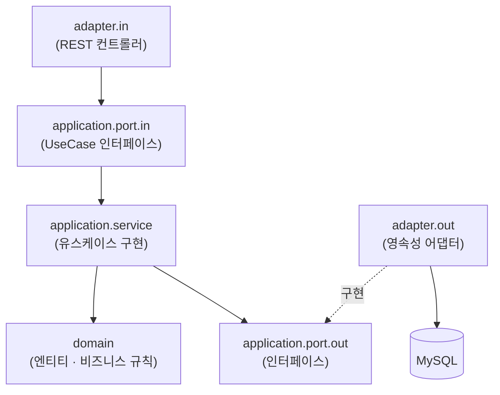
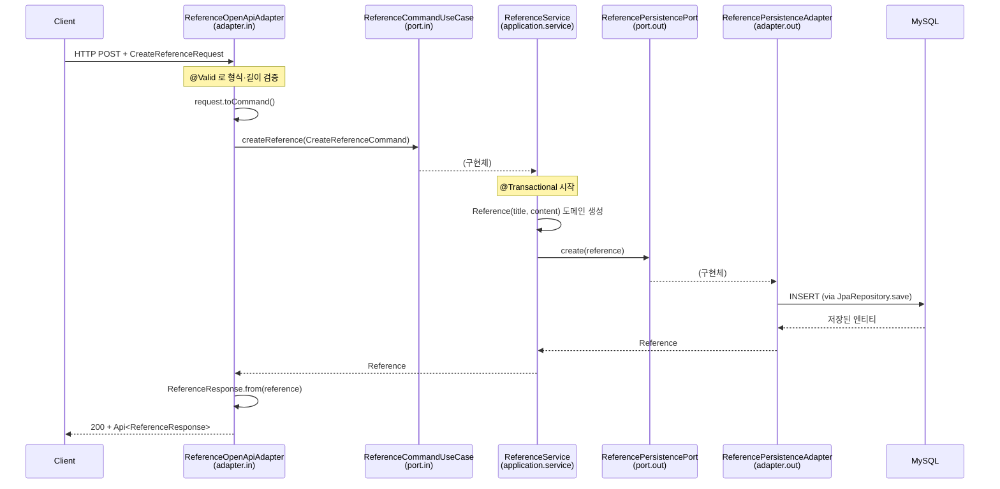

# Hexagonal Architecture Reference

Kotlin · Spring Boot 멀티모듈에서 **헥사고날 아키텍처의 계층 구조**를 어떻게 잡는지 보여주는 레퍼런스 프로젝트.
`reference` 모듈의 레퍼런스 CRUD 하나를 끝까지 구현해, 계층 구분·의존성 방향·네이밍 규칙을 그대로 따라 쓸 수 있게 함.

> ⚠️ 이건 **정통(orthodox) 헥사고날이 아니라, Spring/JPA 환경에 맞춘 실용적 변형**이다.
> 코어(domain + application)가 완전히 프레임워크에서 독립적이지는 않다. 무엇을 의도적으로 타협했는지는 [4.4 이 구현이 택한 타협](#44-이-구현이-택한-타협)에 정리했다.
> 이 트레이드오프는 이 코드가 참고한 실서비스 레퍼런스 모듈에서 그대로 이어받은 것이다.

---

## 목차

1. [스택](#1-스택)
2. [모듈 구성](#2-모듈-구성)
3. [빠른 시작](#3-빠른-시작)
4. [헥사고날 아키텍처](#4-헥사고날-아키텍처) — [4.4 이 구현이 택한 타협](#44-이-구현이-택한-타협)
5. [패키지 구조](#5-패키지-구조)
6. [요청 하나가 계층을 관통하는 흐름](#6-요청-하나가-계층을-관통하는-흐름)
7. [계층별 규칙 요약](#7-계층별-규칙-요약)
8. [새 도메인 추가 체크리스트](#8-새-도메인-추가-체크리스트)
9. [공통 인프라](#9-공통-인프라)
10. [네이밍 규칙](#10-네이밍-규칙)
11. [자주 하는 실수](#11-자주-하는-실수)
12. [문서](#12-문서)

---

## 1. 스택

| 항목 | 버전 / 비고 |
| :-- | :-- |
| 언어 | Kotlin 2.3.21 |
| 빌드 | Gradle (Kotlin DSL), 멀티모듈 |
| JVM | Java toolchain 25 |
| 프레임워크 | Spring Boot 4.1 · Spring Web MVC · Spring Data JPA |
| DB | MySQL 8 (로컬은 `docker-compose.yaml`) |
| 식별자 | TSID (`io.hypersistence:hypersistence-utils`) — 애플리케이션 생성 `Long` |
| 조회 | QueryDSL (Jakarta 지원 OpenFeign 포크) |
| 공통 응답 | `io.github.seob7:common-api` 의 `Api<T>` / `BaseErrorCode` |
| API 문서 | springdoc-openapi (Scalar UI) — `/scalar`, `/v3/api-docs` |

---

## 2. 모듈 구성

`settings.gradle.kts` 의 `include` 로 묶인 멀티모듈이다.

```text
hexagonal
├── common               # 전 모듈 공용 라이브러리 (java-library, 실행 불가)
│                         #   커스텀 어댑터 어노테이션, 공통 예외/핸들러, 공유 DataSource 설정
├── persistence-common   # 영속성 공용 (java-library, 실행 불가)
│                         #   BaseEntity(TSID·감사·논리삭제), PageResponse
└── reference            # 실행 가능한 Spring Boot 애플리케이션 (BootJar 활성)
                          #   헥사고날 계층 구현의 본체
```

- `common` / `persistence-common` 은 `bootJar` 비활성 · `jar` 활성. 순수 라이브러리다.
- `reference` 만 `bootJar` 활성. 실행 진입점은 `ReferenceApplication`.
- 각 모듈·패키지에 `README.md` 를 두어 그 자리에서 규칙을 확인할 수 있다.

---

## 3. 빠른 시작

```bash
# 1) 로컬 MySQL 기동 (기본 접속값은 common/src/main/resources/mysql.yaml 의 기본값과 일치)
docker compose up -d

# 2) 애플리케이션 실행
./gradlew :reference:bootRun

# 3) API 문서
open http://localhost:8080/scalar
```

### 자주 쓰는 명령어

```bash
./gradlew build                  # 전체 모듈 빌드 + 테스트
./gradlew :reference:test        # reference 테스트만
./gradlew :reference:bootRun     # reference 실행
./gradlew :reference:bootJar     # 실행 가능한 jar
```

### API 한눈에

| 메서드 | 경로 | 설명 |
| :-- | :-- | :-- |
| `POST` | `/open-api/reference` | 레퍼런스 생성 |
| `GET` | `/open-api/reference?page=1&size=20` | 목록 조회 (최신순) |
| `GET` | `/open-api/reference/{id}` | 단건 조회 |
| `PUT` | `/open-api/reference/{id}` | 수정 |
| `DELETE` | `/open-api/reference/{id}` | 논리 삭제 |

> 인증이 없는 API 는 `/open-api/...`, 인증이 필요한 API 는 `/api/...` prefix 를 쓴다.

---

## 4. 헥사고날 아키텍처

### 4.1 왜 이렇게 나누나

전통적인 `Controller → Service → Repository` 3계층은 시간이 지나면
서비스가 웹 요청 형식과 JPA 세부 사항을 동시에 알게 되고, 비즈니스 규칙이 프레임워크에 얽힌다.

헥사고날 아키텍처는 **"무엇을 하는가(도메인·유스케이스)" 와 "어떻게 하는가(웹·DB·외부 연동)" 를 분리**한다.

- 핵심(도메인 + application)은 웹·외부 시스템을 모른다. 기술은 전부 바깥의 **어댑터**로 밀어내고, 안쪽은 **포트(인터페이스)** 로만 바깥과 만난다.
- 의존성 화살표는 항상 안쪽을 향한다. → 웹 프레임워크를 바꿔도 핵심은 그대로다.

> 정통 헥사고날은 여기서 한 걸음 더 나아가 **코어가 JPA·Spring 컨테이너·페이징 타입까지 전부 모르게** 한다.
> 이 구현은 거기까지는 가지 않았다. 도메인 엔티티 = JPA 엔티티이고, 포트 시그니처에 Spring Data 타입이 있으며, 수정은 Hibernate 더티 체킹에 기댄다. → [4.4](#44-이-구현이-택한-타협)

### 4.2 포트와 어댑터

```text
        주도(driving) 측                핵심                     피주도(driven) 측
     ┌───────────────────┐   ┌───────────────────────┐   ┌───────────────────┐
     │  adapter.in       │   │  application          │   │  adapter.out      │
     │  REST 컨트롤러 등  │──▶│   port.in (UseCase)   │   │  영속성 / 외부 API │
     │                   │   │       │               │   │        ▲          │
     │                   │   │       ▼               │   │        │ 구현      │
     │                   │   │   service ──▶ domain  │   │        │          │
     │                   │   │       │               │   │        │          │
     │                   │   │       ▼               │   │        │          │
     │                   │   │   port.out  ◀─────────┼───┼────────┘          │
     └───────────────────┘   └───────────────────────┘   └───────────────────┘
          어댑터가 포트를 호출              포트를 어댑터가 구현
```

- **in port** = 유스케이스 인터페이스. "이 애플리케이션이 할 수 있는 일". `adapter.in` 이 호출한다.
- **out port** = 외부 의존 인터페이스. "이 애플리케이션이 필요로 하는 일". `adapter.out` 이 구현한다. (의존성 역전)
- 어댑터는 포트에만 의존한다. 어댑터끼리 직접 부르지 않는다.

### 4.3 의존성 방향 (반드시 지킬 것)



- **domain 은 안쪽 중의 안쪽.** 다른 계층을 의존하지 않는다. (단, 이 구현에서는 JPA 매핑 어노테이션 + `BaseEntity` 상속을 허용 — [4.4](#44-이-구현이-택한-타협))
- **application 은 domain 과 자기 port 만 의존한다.** Spring Web, JPA `Repository`, `Request`/`Response` DTO 를 import 하지 않는다. (`@Service`/`@Transactional`, `Pageable`/`Page` 는 예외로 허용 — [4.4](#44-이-구현이-택한-타협))
- **adapter 는 port(인터페이스)에만 의존한다.** `service` 구현체를 직접 참조하지 않는다.
- 위에 명시한 예외를 제외하고, 바깥 계층 타입이 안쪽으로 새어 들어오면 리뷰 지적 대상이다.

### 4.4 이 구현이 택한 타협

정통 헥사고날 대비, 이 코드가 **의도적으로 지불한 대가**다. 순수 CRUD 모듈에서 코드량을 줄이려는 선택이며,
실서비스 레퍼런스 모듈에서 이어받았다. 도메인 규칙이 복잡해지거나 저장소가 여러 개가 되면 재검토 대상이다.

| # | 타협 | 정통이면 | 지금 이렇게 한 이유 / 영향 |
| :-- | :-- | :-- | :-- |
| 1 | **수정·삭제가 JPA 더티 체킹에 의존.** 아웃 포트에 `save`/`update` 가 없고, 조회한 엔티티를 변경만 하면 커밋 시 저장됨 | 아웃 포트에 명시적 `save(reference)` 를 두고 서비스가 호출 | 코어 동작이 어댑터 *인터페이스* 가 아니라 *기술(Hibernate)* 에 묶임. 아웃 어댑터를 인메모리·REST 로 바꾸면 수정이 조용히 저장 안 됨. **가장 먼저 풀 후보** |
| 2 | **도메인 엔티티 = JPA 엔티티.** `Reference` 가 `@Entity`·`@Column`, `BaseEntity`(`@MappedSuperclass`) | 도메인은 순수 POJO, `adapter/out` 에 별도 `ReferenceJpaEntity` + 매퍼 | "영속 방식" 이 도메인 안으로 들어옴. 코어가 `jakarta.persistence` 에 컴파일 의존. 매퍼·엔티티 이중화를 피하는 대신 순수성을 포기 |
| 3 | **포트 시그니처에 `Page`/`Pageable`** (`org.springframework.data.domain`) — in/out 양쪽 | 자체 `PageQuery`/`PageResult` 정의, 어댑터에서 변환 | application 의 공개 계약이 Spring Data 타입을 노출 |
| 4 | **`domain` → `persistence-common` 의존.** `softDelete()` 가 `BaseEntity` 에 있음 | 논리 삭제를 도메인 개념(`delete()`)으로 올리고 의존 끊기 | 의존 화살표가 바깥(영속)을 향함 |
| 5 | **`@Service`·`@Transactional` 이 application 코어에** | 서비스는 POJO, 트랜잭션은 어댑터/데코레이터로 | 널리 용인되는 타협이지만 엄밀히는 코어에 Spring |
| 6 | **`ReferenceResponse.from(reference)` 가 JPA 엔티티를 직접 읽음.** 컨트롤러가 `PageRequest.of()` 생성 | 도메인 객체 또는 application 결과 모델을 반환 | `@Entity` 가 인바운드 어댑터까지 반환값으로 넘어감 |
| 7 | **전부 한 `reference` 모듈.** 계층 경계는 컨벤션·README 로만 강제 | 계층별 Gradle 모듈 분리 또는 ArchUnit 테스트 | 컴파일러가 방향 위반을 막지 못함 |

**최소 노력 / 최대 효과**로 이 스타일을 개선하려면 #1(더티 체킹 제거)과 #7(ArchUnit 도입)만 해도 된다.
전면 리팩터링(#2·#3)은 코드량이 1.5~2배가 되며, 이 모듈처럼 순수 CRUD 인 경우 이득이 크지 않다.

---

## 5. 패키지 구조

`reference` 모듈 기준. 새 도메인도 동일한 트리를 만든다.

```text
com.hexagonal.reference
├── ReferenceApplication.kt          # @SpringBootApplication(scanBasePackages = ["com.hexagonal"]) + @EnableJpaAuditing
├── config/
│   ├── OpenApiConfig.kt             # OpenAPI 메타데이터
│   └── QuerydslConfig.kt            # JPAQueryFactory 빈 (실행 모듈에서 등록)
├── domain/                          # ── 도메인 모델 (비즈니스 규칙의 중심)
│   └── Reference.kt
├── application/
│   ├── port/
│   │   ├── in/                      # 인바운드 포트 = 유스케이스 인터페이스
│   │   │   ├── ReferenceCommandUseCase.kt
│   │   │   ├── ReferenceQueryUseCase.kt
│   │   │   └── dto/                 # 유스케이스 입력 모델 (Command)
│   │   │       ├── CreateReferenceCommand.kt
│   │   │       └── UpdateReferenceCommand.kt
│   │   └── out/                     # 아웃바운드 포트 = 외부 의존성 인터페이스
│   │       └── ReferencePersistencePort.kt
│   └── service/                     # 유스케이스 구현체 (오케스트레이션 + 트랜잭션)
│       └── ReferenceService.kt
└── adapter/
    ├── in/                          # 주도(driving) 어댑터
    │   ├── ReferenceOpenApiAdapter.kt
    │   └── dto/                     # 외부 노출 모델 (Request / Response)
    │       ├── CreateReferenceRequest.kt
    │       ├── UpdateReferenceRequest.kt
    │       └── ReferenceResponse.kt
    └── out/                         # 피주도(driven) 어댑터
        └── persistence/
            ├── ReferencePersistenceAdapter.kt
            └── repository/
                ├── ReferenceRepository.kt        # Spring Data JPA
                └── ReferenceQueryRepository.kt   # QueryDSL
```

> `in` 은 Kotlin 예약어라 패키지 선언·import 에서 백틱으로 감싼다: `` com.hexagonal.reference.adapter.`in` ``

각 디렉터리의 `README.md` 에 그 계층의 세부 규칙과 파일 설명이 있다.

---

## 6. 요청 하나가 계층을 관통하는 흐름

`POST /open-api/reference` (레퍼런스 생성) 한 요청을 따라가 보면:



계층마다 **전용 모델**을 쓰고, 엔티티는 경계를 넘지 않는다:

```text
CreateReferenceRequest  --toCommand()-->  CreateReferenceCommand  -->  ReferenceService  -->  Reference(domain)
                                                                                                   │
ReferenceResponse  <--from(reference)-------------------------------------------------------------──┘
```

| 모델 | 위치 | 성격 |
| :-- | :-- | :-- |
| `*Request` / `*Response` | `adapter/in/dto` | HTTP 경계. 검증 어노테이션 있음. `data class` |
| `*Command` | `application/port/in/dto` | 유스케이스 입력. 프레임워크 어노테이션 없음. `data class` |
| `Reference` | `domain` | 비즈니스 규칙 + JPA 엔티티(같은 클래스가 두 역할 — [4.4 #2](#44-이-구현이-택한-타협)). 일반 `class` |

---

## 7. 계층별 규칙 요약

### domain — [`domain/README.md`](reference/src/main/kotlin/com/hexagonal/reference/domain/README.md)

- application·adapter 를 의존하지 않는다. (JPA 매핑 어노테이션 + `BaseEntity` 는 이 구현의 타협 — [4.4](#44-이-구현이-택한-타협))
- `data class` 금지, 일반 `class`. 상태 변경은 `update()` 같은 의미 있는 메서드로.
- 생성자에 `Command` 를 넘기지 않는다. N:1 / 1:1 은 `FetchType.LAZY` 명시.

### application — [`application/README.md`](reference/src/main/kotlin/com/hexagonal/reference/application/README.md)

- **CQS**: 인바운드 포트를 `*CommandUseCase`(쓰기) / `*QueryUseCase`(읽기) 로 분리. 한 `*Service` 가 둘 다 구현 가능.
- 트랜잭션: 클래스에 `@Transactional(readOnly = true)`, 쓰기 메서드에만 `@Transactional` 재정의.
- **수정·삭제는 현재 JPA 더티 체킹으로 반영된다** — 조회한 엔티티의 도메인 메서드를 호출하고 `save()` 를 다시 부르지 않는다. 이건 이 구현의 타협이다([4.4 #1](#44-이-구현이-택한-타협)). 정통이라면 아웃 포트의 명시적 `save()` 를 호출한다.
- 서비스는 오케스트레이션만. 비즈니스 규칙은 도메인으로.

### adapter — [`adapter/README.md`](reference/src/main/kotlin/com/hexagonal/reference/adapter/README.md)

- `in`: `*UseCase` 인터페이스에만 의존. 컨트롤러는 얇게(변환 → 호출 → 변환). 경로·메서드 순서(C→R→U→D) 규칙.
- `out`: 아웃바운드 포트 구현. JPA·QueryDSL 세부 사항 격리. 조회 실패는 `NotFoundException` 으로 변환(`null` 반환 금지).
- 프레임워크 어노테이션 대신 `@WebInputAdapter` / `@WebOutputAdapter` / `@PersistenceAdapter` 를 쓴다.

---

## 8. 새 도메인 추가 체크리스트

`user` 도메인을 새로 만든다고 하면:

1. `com.hexagonal.user` 아래 [5장](#5-패키지-구조)과 동일한 트리를 만든다.
2. `domain/User.kt` — `BaseEntity` 상속, 일반 `class`, 상태 변경 메서드.
3. `application/port/in/` — `UserCommandUseCase`, `UserQueryUseCase` + `dto/*Command`.
4. `application/port/out/` — `UserPersistencePort` (도메인 언어로).
5. `application/service/UserService` — 포트 구현, 트랜잭션 경계.
6. `adapter/in/` — `UserOpenApiAdapter`(`@WebInputAdapter("/open-api/user")`) + `dto/*Request` `*Response`.
7. `adapter/out/persistence/` — `UserPersistenceAdapter`(`@PersistenceAdapter`) + `repository/`.
8. 조회 실패용 에러 코드: `common` 의 `NotFoundErrorCode` 에 `USER_NOT_FOUND` 추가.
9. 각 디렉터리에 `README.md` (기존 것 복제 후 수정).
10. 테스트: 도메인 로직 → 서비스(포트 대역) → 어댑터 슬라이스 순.

> 별도 실행 모듈로 뺄지, `reference` 처럼 도메인마다 모듈을 만들지는 서비스 규모에 따라 결정한다.
> 이 레퍼런스는 "한 모듈 = 한 실행 애플리케이션 + 그 안에 도메인들" 도, "도메인 = 모듈" 도 모두 지원하는 구조다.

---

## 9. 공통 인프라

### BaseEntity (`persistence-common`) — [README](persistence-common/README.md)

모든 엔티티가 상속한다. 직접 재정의 금지.

- **식별자**: DB auto-increment 가 아니라 `@Tsid` 로 애플리케이션에서 생성하는 `Long`.
- **감사**: `createdAt` / `updatedAt` 은 JPA Auditing 이 채운다 → 실행 앱에 `@EnableJpaAuditing` 필수.
- **논리 삭제**: 물리 삭제하지 않고 `softDelete()` 로 `deletedAt` 에 시각을 찍는다. 조회는 `...AndDeletedAtIsNull`.

### 공통 예외 처리 (`common`) — [README](common/src/main/kotlin/com/hexagonal/common/exception/README.md)

- 도메인·영속성 계층에서 `NotFoundException(NotFoundErrorCode.XXX)` 만 던지면,
  `@RestControllerAdvice` 핸들러가 공통 응답 규격 `Api.ERROR` 로 변환한다.
- `@Valid` 검증 실패도 `ValidationExceptionHandler` 가 필드 메시지를 모아 처리한다.
- **실행 모듈은 `@SpringBootApplication(scanBasePackages = ["com.hexagonal"])`** 로 common 의 어드바이스를 스캔해야 한다.

### 커스텀 어댑터 어노테이션 (`common`)

| 어노테이션 | 메타 | 용도 |
| :-- | :-- | :-- |
| `@WebInputAdapter(vararg path)` | `@RestController` + `@RequestMapping` | 인바운드 REST 어댑터. 생성자 인자로 base path |
| `@WebOutputAdapter` | `@Component` | 아웃바운드 어댑터(외부 API 호출 등) |
| `@PersistenceAdapter` | `@Repository` | 아웃바운드 영속성 어댑터 |

### 공통 응답 규격

모든 응답은 `Api<T>` 로 감싼다.

```jsonc
{
  "metaData": { "success": true, "code": 0, "message": "..." },
  "data": { }   // 실패 시 null
}
```

---

## 10. 네이밍 규칙

| 대상 | 규칙 | 예 |
| :-- | :-- | :-- |
| 패키지 | 소문자 단일 단어, `_` 금지 | `com.hexagonal.reference.adapter` |
| 클래스 / 인터페이스 | 명사형 PascalCase | `ReferenceService` |
| 함수 / 변수 | camelCase | `createReference()`, `referenceId` |
| 컴파일 타임 상수 | `const val` UPPER_SNAKE_CASE | `MAX_TITLE_LENGTH` |
| 인바운드 포트 | `*UseCase` (`Command` / `Query` 분리) | `ReferenceCommandUseCase` |
| 유스케이스 입력 | `*Command` | `CreateReferenceCommand` |
| 아웃바운드 포트 | `*Port` (도메인 언어) | `ReferencePersistencePort` |
| HTTP 요청 / 응답 | `*Request` / `*Response` | `CreateReferenceRequest` |
| 영속성 어댑터 | `*PersistenceAdapter` | `ReferencePersistenceAdapter` |
| 조회 반환 | `get*` = nullable / `find*` = non-null(없으면 예외) | `findReference()` |

전체 코드 스타일은 [`docs/code-convention.md`](docs/code-convention.md).

---

## 11. 자주 하는 실수

| 하면 안 되는 것 | 대신 |
| :-- | :-- |
| `Service` 에서 `Repository` 직접 주입 | 아웃바운드 포트(`*Port`)에 의존 |
| 컨트롤러에서 `ReferenceService` 직접 주입 | `*UseCase` 인터페이스에 의존 |
| 엔티티를 `@RequestBody` / 응답으로 사용 | `*Request` / `*Response` DTO |
| `application` 에서 `jakarta.persistence` / `org.springframework.web` import | 포트·도메인 타입만 사용 (`@Transactional`, `Pageable` 은 [4.4](#44-이-구현이-택한-타협) 범위에서만) |
| 수정 시 `repository.save()` 재호출 | 조회한 엔티티의 도메인 메서드 호출 (현재는 더티 체킹으로 반영 — [4.4 #1](#44-이-구현이-택한-타협)) |
| 포트가 `null` 반환 → 상위에서 `null` 체크 | 어댑터에서 `NotFoundException` 으로 끊기 |
| 물리 삭제 (`delete`) | `softDelete()` + `deletedAt IS NULL` 조회 |
| `data class` 로 JPA 엔티티 선언 | 일반 `class` (프록시·순환참조 문제) |
| URL 에 동사 (`/reference/create`) | 자원 중심 URL + HTTP 메서드 |

---

## 12. 문서

- [`docs/code-convention.md`](docs/code-convention.md) — 코드 스타일·JPA·DTO·검증 규칙
- [`docs/git-convention.md`](docs/git-convention.md) — 브랜치 전략·커밋 메시지 규칙
- 각 패키지의 `README.md` — 그 계층의 세부 규칙
